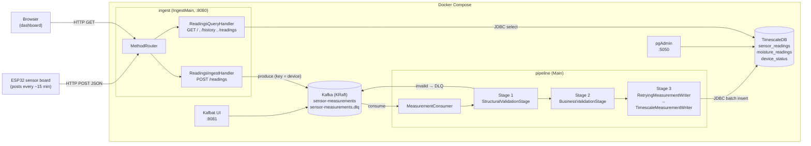
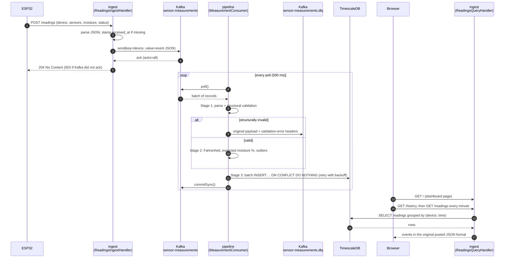
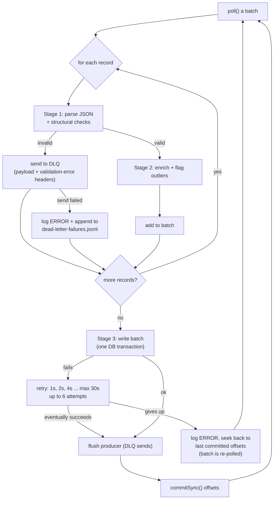
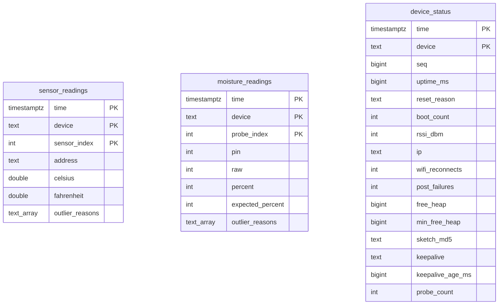

# Sensor Measurement Service

Collects temperature and soil-moisture measurements from an ESP32 vermiculture sensor board, validates them, flags outliers, and stores them in TimescaleDB. It also serves the web dashboard that charts the bins over time.

The ESP32 posts a JSON event to `POST /readings` about every 15 minutes. The **ingest** service publishes that event to Kafka. The **pipeline** service consumes it in three stages:

1. **Structural validation.** It parses the JSON and checks the required fields. Bad events go to a dead-letter topic.
2. **Business validation and metadata.** It converts to Fahrenheit, computes the expected moisture percent from the probe calibration, and flags outliers.
3. **Persistence.** It writes to TimescaleDB hypertables, retrying with backoff.

The ingest service also serves the read side: `GET /history`, `GET /readings`, and the dashboard page at `/`. Kafbat UI and pgAdmin are included for administering Kafka and the database.

Everything runs with Docker Compose. Java 21, Gradle (Groovy DSL), plain `kafka-clients`, JDBC and Flyway, with no framework.

---

## Contents

- [Architecture](#architecture)
- [Services and ports](#services-and-ports)
- [Quick start](#quick-start)
- [Running the services](#running-the-services)
- [Configuration](#configuration)
- [HTTP API](#http-api)
- [Event format](#event-format)
- [Pipeline stages in detail](#pipeline-stages-in-detail)
- [Database schema](#database-schema)
- [Delivery guarantees and failure handling](#delivery-guarantees-and-failure-handling)
- [Testing](#testing)
- [Importing history from the Python server](#importing-history-from-the-python-server)
- [Pulling history from the ESP32](#pulling-history-from-the-esp32)
- [Using Kafbat UI (Kafka)](#using-kafbat-ui-kafka)
- [Using pgAdmin (TimescaleDB)](#using-pgadmin-timescaledb)
- [Data, persistence and backups](#data-persistence-and-backups)
- [Troubleshooting](#troubleshooting)
- [Project layout](#project-layout)

---

## Architecture

### Component diagram



### End-to-end sequence



### Batch processing and error handling (activity)



---

## Services and ports

| Service | Container | Purpose | Host address |
| --- | --- | --- | --- |
| `kafka` | `sensor-kafka` | Single-node Kafka 3.9 in KRaft mode | `localhost:9092` |
| `kafka-init` | (one-off) | Creates `sensor-measurements` (3 partitions) and `sensor-measurements.dlq` (1 partition), then exits | none |
| `timescaledb` | `sensor-timescaledb` | PostgreSQL 17 + TimescaleDB, database/user/password `sensors` | `localhost:5432` |
| `ingest` | `sensor-ingest` | HTTP: ESP32 posts, dashboard, history API | `0.0.0.0:8080` (reachable on your LAN) |
| `pipeline` | `sensor-pipeline` | Kafka consumer running the three stages | none |
| `kafka-ui` | `sensor-kafka-ui` | Kafbat UI v1.5.0 | `http://127.0.0.1:8081` |
| `pgadmin` | `sensor-pgadmin` | pgAdmin 4 v9.19 | `http://127.0.0.1:5050` |

`ingest` and `pipeline` run from the same image, `sensor-measurement-service`, and differ only in the main class. The admin UIs listen on `127.0.0.1` only, so other machines can't reach them.

None of the services has a restart policy. Start and stop them yourself with `docker compose`.

---

## Quick start

Prerequisites:

- **Docker Desktop**, with Compose v2.
- **JDK 21 or newer**, only if you want to build or test outside Docker. The Gradle wrapper downloads Gradle itself.

```powershell
# Build the application image and start everything
docker compose up -d --build

# Check status
docker compose ps

# Follow logs of the two application services
docker compose logs -f ingest pipeline
```

Then open:

- Dashboard: <http://localhost:8080/>
- Kafbat UI: <http://localhost:8081/>
- pgAdmin: <http://localhost:5050/> (login `admin@example.com` / `admin`)

Point the ESP32 at `http://<this-pc-lan-ip>:8080/readings`. Allow inbound TCP 8080 in Windows Firewall if the board can't connect.

---

## Running the services

### Common commands

```powershell
docker compose up -d                    # start everything (no rebuild)
docker compose up -d --build            # rebuild the app image after code changes, then start
docker compose build ingest pipeline    # rebuild only the app image
docker compose stop                     # stop all containers (data is kept)
docker compose stop ingest              # stop one service
docker compose start ingest             # start it again
docker compose down                     # remove containers and network (data in ./data is kept)
docker compose logs -f pipeline         # follow one service's logs
docker compose ps                       # status and health
```

Startup order is enforced by `depends_on`:

1. `kafka` becomes healthy.
2. `kafka-init` creates the topics and exits.
3. `timescaledb` becomes healthy.
4. `ingest` and `pipeline` start.

The `pipeline` service runs the Flyway migrations at startup. Run it at least once before using the dashboard on a fresh database, or `/history` returns 503 until the tables exist.

### Running the Java services on the host (development)

You can run either application from Gradle while the infrastructure stays in Docker. Stop the container version first so they don't compete for port 8080 or the consumer group.

```powershell
docker compose up -d kafka kafka-init timescaledb
docker compose stop ingest pipeline

.\gradlew.bat run          # pipeline (com.kevrsc.sensor.app.Main)
.\gradlew.bat runIngest    # ingest + dashboard (com.kevrsc.sensor.app.IngestMain) on :8080
```

On the host the defaults point at `localhost:9092` and `localhost:5432`, so nothing needs configuring.

---

## Configuration

Every setting is an environment variable with a default. For Compose, put overrides in a `.env` file next to `docker-compose.yml`:

```dotenv
INGEST_ADVERTISED_HOST=192.168.1.10:8080
TZ=America/Los_Angeles
PGADMIN_EMAIL=me@example.com
PGADMIN_PASSWORD=change-me
```

### Compose-level

| Variable | Default | Used by | Meaning |
| --- | --- | --- | --- |
| `INGEST_HOST_PORT` | `8080` | ingest | Host port mapped to the ingest container |
| `INGEST_ADVERTISED_HOST` | (empty) | ingest | `host:port` printed in the startup log as the ESP32 and dashboard address. Without it, the container's internal IP is printed. |
| `TZ` | `America/Los_Angeles` | ingest, pipeline | Zone used for `received_at` stamps and for times returned by `/history` |
| `KAFKA_UI_PORT` | `8081` | kafka-ui | Host port, bound to 127.0.0.1 |
| `PGADMIN_PORT` | `5050` | pgadmin | Host port, bound to 127.0.0.1 |
| `PGADMIN_EMAIL` / `PGADMIN_PASSWORD` | `admin@example.com` / `admin` | pgadmin | pgAdmin login. Only applied the first time pgAdmin creates `data/pgadmin`. |

### ingest (`IngestMain`)

| Variable | Default |
| --- | --- |
| `INGEST_HOST` | `0.0.0.0` |
| `INGEST_PORT` | `8080` |
| `KAFKA_BOOTSTRAP_SERVERS` | `localhost:9092` (Compose: `kafka:19092`) |
| `SENSOR_TOPIC` | `sensor-measurements` |
| `DB_URL` | `jdbc:postgresql://localhost:5432/sensors` (Compose: `...//timescaledb:5432/sensors`) |
| `DB_USER` / `DB_PASSWORD` | `sensors` / `sensors` |
| `INGEST_ADVERTISED_HOST` | (empty) |
| `LAN_PROBE_ADDRESS` | `8.8.8.8`. Used only to work out which local interface address to print. No traffic is sent. |

The ingest producer is tuned to give up within an HTTP request: `max.block.ms=5000`, `request.timeout.ms=5000` and `delivery.timeout.ms=10000`. The handler waits at most 15 s before answering 503.

### pipeline (`Main`)

| Variable | Default |
| --- | --- |
| `KAFKA_BOOTSTRAP_SERVERS` | `localhost:9092` |
| `KAFKA_GROUP_ID` | `sensor-measurement-service` |
| `SENSOR_TOPIC` | `sensor-measurements` |
| `SENSOR_DLQ_TOPIC` | `<SENSOR_TOPIC>.dlq` |
| `DLQ_FAILURES_FILE` | `dead-letter-failures.jsonl` (Compose: `/app/dlq/...`, which is `./data/dlq/` on the host) |
| `DB_URL`, `DB_USER`, `DB_PASSWORD` | as above |
| `MOISTURE_CALIBRATION_FILE` | (empty). Uses the bundled `src/main/resources/moisture-calibration.json`. |

### Moisture calibration

The ESP32 converts the raw analog moisture value to a percent. Percent is 0 at the dry raw value, measured in air, and 100 at the wet raw value, measured with the blade dipped in water. A higher raw value is drier. The pipeline recomputes the expected percent from the raw value to catch boards with stale calibration.

The bundled `src/main/resources/moisture-calibration.json` has a default and per-device, per-probe overrides keyed by probe `index`:

```json
{
  "default": { "dry_raw": 3500, "wet_raw": 1550 },
  "devices": {
    "vermiculture-esp32": {
      "0": { "dry_raw": 3500, "wet_raw": 1550 }
    }
  }
}
```

To change it, edit the file and rebuild the image (`docker compose up -d --build pipeline`). Or mount a different file and set `MOISTURE_CALIBRATION_FILE` to its path inside the container. `dry_raw` must be greater than `wet_raw`, or the pipeline refuses to start.

---

## HTTP API

All responses send `Cache-Control: no-store`.

| Method and path | Response |
| --- | --- |
| `POST /readings` | **204** once Kafka has acknowledged the event. **400** `expected JSON` or `expected a JSON object`. **503** `could not store reading` if Kafka didn't acknowledge within 15 s. |
| `GET /readings` | **200**, the latest stored event as JSON, or `null` when the database is empty. **503** if the database can't be read. |
| `GET /history` | **200**, a JSON array of every stored event, oldest first. **503** on database errors. |
| `GET /` | **200**, the dashboard (`src/main/resources/web/index.html`) |
| other paths | **404** `not found` |
| other methods | **405**, with `Allow: GET, POST` |

`POST /readings` publishes the body unchanged, apart from one case: a missing or blank `received_at` is set to the server's local time with its offset, for example `2026-11-10T11:38:21-08:00`. The Kafka record key is the `device` field.

`/history` and `/readings` rebuild events from the database in the same shape the ESP32 posts. That's why the dashboard copied from the original Python server works unchanged.

Try it:

```powershell
$body = Get-Content src/test/resources/esp32-sensor-event.json -Raw
Invoke-WebRequest http://localhost:8080/readings -Method Post -ContentType application/json -Body $body -UseBasicParsing
Invoke-RestMethod http://localhost:8080/readings
```

---

## Event format

Example from `src/test/resources/esp32-sensor-event.json`:

```json
{
  "device": "vermiculture-esp32",
  "sensors": [
    { "index": 0, "address": "28107bd400000057", "celsius": 18.06 }
  ],
  "moisture": [
    { "index": 0, "pin": 35, "raw": 1879, "percent": 83 }
  ],
  "status": {
    "uptime_ms": 229504121, "reset_reason": "POWERON", "boot_count": 3, "rssi_dbm": -58,
    "ip": "192.168.1.20", "wifi_reconnects": 2, "post_failures": 255, "seq": 256,
    "free_heap": 187372, "min_free_heap": 146388, "sketch_md5": "0123456789abcdeffedcba9876543210",
    "keepalive": "disabled", "keepalive_age_ms": null, "probe_count": 4
  },
  "received_at": "2026-11-09T11:56:34-08:00"
}
```

- `sensors` holds DS18B20 temperature probes. `index` is assigned by the device and identifies the probe in error messages, and `address` is the 1-Wire ROM code.
- `sensors` and `moisture` may be empty or missing, which is treated as empty, and may hold several readings.
- `status` is optional; older posts don't have it.
- Unknown fields are ignored.

---

## Pipeline stages in detail

### Stage 1: structural validation (`StructuralValidationStage`)

An event fails if any of these is true. All errors are collected, not just the first.

| Check | Error message |
| --- | --- |
| Body is not valid JSON or doesn't fit the event shape | `malformed event JSON: ...` |
| `device` missing or blank | `device is required` |
| Two sensors share an `index` | `sensors[<index>] index is duplicated` |
| A sensor has no `address` | `sensors[<index>].address is required` |
| `received_at` missing | `receivedAt is required` |

Invalid events go to `sensor-measurements.dlq` unchanged, with the same key, and with one `validation-error` header per error.

### Stage 2: business validation and metadata (`BusinessValidationStage`)

For each event it adds:

- **Fahrenheit** for every sensor, rounded to 0.1 °F.
- **Expected moisture percent** from the probe's calibration: `round((dry_raw - raw) * 100 / (dry_raw - wet_raw))`.
- **Outliers.** These are flagged, not rejected; the event is always stored.

| Outlier | Rule (limits inclusive) | Reason stored |
| --- | --- | --- |
| Temperature | Fahrenheit, rounded to 0.1, outside 0–100 °F | `temperature 104.0F is outside 0F-100F` |
| Moisture past the wet limit | raw < `wet_raw` | `raw 1512 is wetter than the calibrated wet limit 1550; probe needs recalibration` |
| Moisture past the dry limit | raw > `dry_raw` | `raw 3600 is drier than the calibrated dry limit 3500; probe needs recalibration` |
| Moisture calibration mismatch | \|expected (capped to 0–100) − percent\| > 1 | `percent 83 does not match raw 2200 (expected 67); check device calibration` |

The board caps the percent it sends at 0–100. A reading past the calibrated limits is therefore detected from the raw value, and the mismatch check compares the board's percent with the expected percent capped the same way. The stored `expected_percent` is not capped, for example 102 for raw 1512, so you can see how far past the limit a reading was.

### Stage 3: persistence (`TimescaleMeasurementWriter`, wrapped in `RetryingMeasurementWriter`)

- Each poll's batch of valid events is written in one transaction.
- Inserts use `ON CONFLICT DO NOTHING`, so replays and re-imports are idempotent.
- A failed write is retried up to 6 attempts, with exponential backoff of 1 s, 2 s, 4 s and so on, capped at 30 s. That's about 30 s of waiting before it gives up.

---

## Database schema

Managed by Flyway (`src/main/resources/db/migration`). The three tables are TimescaleDB hypertables partitioned on `time`, which is the event's `received_at`.



A single posted event becomes one row per sensor, one row per moisture probe, and at most one `device_status` row, all sharing `(device, time)`. The tables have no foreign keys; `(device, time)` is the logical event key.

---

## Delivery guarantees and failure handling

- **Ingest to Kafka:** the ESP32 gets 204 only after Kafka acknowledged the write with `acks=all` and an idempotent producer. If it gets a 503, the post wasn't stored. Its `post_failures` counter reflects that.
- **Kafka to the database:** at-least-once. Offsets are committed manually, and only after the batch has been written and the DLQ sends flushed. If the pipeline crashes mid-batch, the batch is reprocessed, and `ON CONFLICT DO NOTHING` drops the duplicates.
- **Database outage:** the writer retries for about 30 seconds. Then the consumer rewinds to the last committed offsets and tries the same batch again on the next poll. Nothing is skipped.
- **No poison pills:** a bad message is dead-lettered and processing continues. If even the DLQ send fails, the record is logged at ERROR and appended to `data/dlq/dead-letter-failures.jsonl` for manual follow-up, and processing still continues.
- **Duplicates:** a replay can produce duplicate DLQ messages. Two different posts from the same device stamped with the same second keep only the first.
- **Shutdown:** `docker compose stop` sends SIGTERM. The pipeline wakes the consumer, finishes, and closes cleanly. The ingest service stops accepting requests and closes its producer.

---

## Testing

| Command | Runs | Needs Docker |
| --- | --- | --- |
| `.\gradlew.bat test` | Unit tests (`src/test`): parsing, validation, outliers, calibration, consumer loop with `MockConsumer`/`MockProducer`, HTTP handlers on an in-process server, retry policy, history import | No |
| `.\gradlew.bat integrationTest` | Integration tests (`src/integrationTest`): Flyway migrations, writer and reader against a real TimescaleDB started by Testcontainers | Yes |
| `.\gradlew.bat check` or `.\gradlew.bat build` | Both suites, plus compile and packaging | Yes |

Run a single class or test:

```powershell
.\gradlew.bat test --tests "*OutlierDetectorTest"
.\gradlew.bat integrationTest --tests "*MeasurementHistoryReaderTest"
```

Reports are written to `build/reports/tests/test/index.html` and `build/reports/tests/integrationTest/index.html`.

Notes:

- Integration tests pull `timescale/timescaledb:latest-pg17` on first run. Testcontainers 1.21.x is required for Docker Engine 29.
- They don't touch the Compose database; each test class gets its own throwaway container.

### Manual end-to-end check

```powershell
docker compose up -d --build
$body = Get-Content src/test/resources/esp32-sensor-event.json -Raw
Invoke-WebRequest http://localhost:8080/readings -Method Post -ContentType application/json -Body $body -UseBasicParsing   # expect 204
Invoke-WebRequest http://localhost:8080/readings -Method Post -ContentType application/json -Body 'nope' -UseBasicParsing   # expect 400
docker compose logs pipeline --since 1m
```

Then look at the message in Kafbat UI and at the rows in pgAdmin. To dead-letter something, send JSON that is structurally invalid, for example `{"sensors":[]}` with no device. The stored test event keeps the sample's `received_at`, so delete it afterwards if you don't want it in your history. See [useful queries](#useful-queries).

---

## Importing history from the Python server

`HistoryImportMain` publishes each line of a `readings.jsonl` file unchanged to `sensor-measurements`, keyed by device. Imported history therefore goes through the same validation, enrichment and storage as live posts. Lines that aren't JSON are still published, so they end up in the DLQ, and their line numbers are logged.

```powershell
docker compose run --rm --no-deps `
  -v "C:\dev\vermiculture-sensors\server:/import:ro" `
  ingest com.kevrsc.sensor.app.HistoryImportMain /import/readings.jsonl
```

Re-running is safe for the database because of `ON CONFLICT DO NOTHING`, but every line is added to the Kafka topic again.

---

## Pulling history from the ESP32

`Esp32HistoryPullMain` fetches `GET /history` from the board once and publishes each array element to `sensor-measurements`, keyed by `device`. The board already returns the same event shape the pipeline consumes. An optional second argument is a Unix timestamp, sent as `?after=`, and the board leaves out samples at or before that time. Nothing is saved between runs, so the next run pulls the ring again.

Run it on the host so `vermiculture.local` resolves and Kafka is reached at `localhost:9092`:

```powershell
.\gradlew.bat pullEsp32History --args="http://vermiculture.local"
.\gradlew.bat pullEsp32History --args="http://vermiculture.local 1731000000"
```

From a container, use the board's LAN address. mDNS names do not resolve there, and the compose network supplies the Kafka brokers:

```powershell
docker compose run --rm --no-deps ingest com.kevrsc.sensor.app.Esp32HistoryPullMain http://192.168.x.x
```

The stack should already be up. Re-running is safe for the database because of `ON CONFLICT DO NOTHING`, but every sample is added to the Kafka topic again. The request waits up to 5 minutes for the ring.

---

## Using Kafbat UI (Kafka)

Open <http://localhost:8081>. The cluster is named **sensors**. There's no login, because the UI only listens on localhost.

| Task | Where |
| --- | --- |
| See the topics, partitions and message counts | **Topics** |
| Read live events | **Topics → `sensor-measurements` → Messages**. Use *Seek type* (offset or timestamp) and the partition selector. Records are keyed by `device`, so a device's events stay on one partition. |
| Inspect rejected events and why | **Topics → `sensor-measurements.dlq` → Messages**. Open a message and view **Headers**; each `validation-error` header is one structural error. |
| Check that the pipeline keeps up | **Consumers → `sensor-measurement-service`**. *Consumer lag* should be 0 between posts, and each partition shows the committed offset. |
| Send a test event | **Topics → `sensor-measurements` → Produce Message**. Set key `vermiculture-esp32` and paste an event as the value. It bypasses the HTTP ingest, including the `received_at` stamping, so include `received_at`. |
| Topic configuration (retention etc.) | **Topics → topic → Settings** |

Cautions:

- **Reset offsets** (*Consumers → group → Reset offsets*) only works while the group is inactive, so run `docker compose stop pipeline` first. Resetting to the earliest offset replays everything. That's safe for the database thanks to `ON CONFLICT DO NOTHING`, but it re-sends anything invalid to the DLQ.
- Kafka's data isn't kept in `./data`, so after `docker compose down` the next `up` starts with empty topics. `stop` and `start` keep them. The database already holds everything that was consumed, so this only matters for messages not yet processed.

---

## Using pgAdmin (TimescaleDB)

Open <http://localhost:5050> and log in with `admin@example.com` / `admin`, or your `PGADMIN_EMAIL` and `PGADMIN_PASSWORD`.

1. The server **sensors (TimescaleDB)** is pre-registered from `docker/pgadmin/servers.json`.
2. The first time you expand it, pgAdmin asks for the database password: `sensors`. Tick **Save password**.
3. Browse to **Databases → sensors → Schemas → public → Tables**. Right-click a table and choose **View/Edit Data → Last 100 Rows**.
4. For ad-hoc SQL, select the `sensors` database and open **Tools → Query Tool** (Alt+Shift+Q). Run with F5.

pgAdmin keeps its own settings, saved passwords and query history in `data/pgadmin`. `servers.json` is imported only on pgAdmin's first start. If you change it, delete `data/pgadmin` and restart pgAdmin.

### Useful queries

```sql
-- Latest temperature per probe (local time)
SELECT DISTINCT ON (sensor_index)
       sensor_index, address, fahrenheit, time AT TIME ZONE 'America/Los_Angeles' AS local_time
FROM sensor_readings
WHERE device = 'vermiculture-esp32'
ORDER BY sensor_index, time DESC;

-- Hourly average temperature per probe over the last 24 hours (TimescaleDB time_bucket)
SELECT time_bucket('1 hour', time) AS hour, sensor_index, round(avg(fahrenheit)::numeric, 1) AS avg_f
FROM sensor_readings
WHERE time > now() - interval '24 hours'
GROUP BY hour, sensor_index
ORDER BY hour, sensor_index;

-- Every flagged outlier, newest first
SELECT time, 'sensor' AS kind, sensor_index AS idx, outlier_reasons FROM sensor_readings WHERE outlier_reasons <> '{}'
UNION ALL
SELECT time, 'moisture', probe_index, outlier_reasons FROM moisture_readings WHERE outlier_reasons <> '{}'
ORDER BY time DESC;

-- Board health trend: signal, failed posts, memory
SELECT time, seq, rssi_dbm, post_failures, wifi_reconnects, free_heap, reset_reason
FROM device_status ORDER BY time DESC LIMIT 50;

-- Gaps longer than 30 minutes between posts
SELECT prev_time, time, time - prev_time AS gap
FROM (SELECT time, lag(time) OVER (ORDER BY time) AS prev_time
      FROM (SELECT DISTINCT time FROM sensor_readings WHERE device = 'vermiculture-esp32') posts) t
WHERE time - prev_time > interval '30 minutes'
ORDER BY time DESC;

-- Hypertables and their chunks
SELECT hypertable_name, num_chunks FROM timescaledb_information.hypertables;

-- Delete one event (all three tables) by its exact time
BEGIN;
DELETE FROM sensor_readings   WHERE device = 'vermiculture-esp32' AND time = '2026-11-09 11:56:34-08';
DELETE FROM moisture_readings WHERE device = 'vermiculture-esp32' AND time = '2026-11-09 11:56:34-08';
DELETE FROM device_status     WHERE device = 'vermiculture-esp32' AND time = '2026-11-09 11:56:34-08';
COMMIT;
```

---

## Data, persistence and backups

| Path | Contents | Survives `docker compose down` |
| --- | --- | --- |
| `data/timescaledb/` | PostgreSQL data directory, bind-mounted | Yes |
| `data/pgadmin/` | pgAdmin settings and saved passwords | Yes |
| `data/dlq/dead-letter-failures.jsonl` | Events whose DLQ send failed | Yes |
| Kafka log | Anonymous Docker volume of `sensor-kafka` | No. It survives `stop`/`start`, but after `down` a new container starts with empty topics. |

`data/` is git-ignored. Deleting `data/timescaledb` deletes the measurement history.

Copy `data/timescaledb` only while the database is stopped (`docker compose stop timescaledb`); a copy taken while it runs can be inconsistent. While it's running, take a logical backup instead:

```powershell
New-Item -ItemType Directory -Force backups | Out-Null
docker exec sensor-timescaledb pg_dump -U sensors -d sensors -Fc -f /tmp/sensors.dump
docker cp sensor-timescaledb:/tmp/sensors.dump backups/sensors-$(Get-Date -Format yyyyMMdd-HHmm).dump
```

To restore into an empty database, use [the TimescaleDB restore procedure](https://docs.timescale.com/self-hosted/latest/backup-and-restore/logical-backup/). It runs `SELECT timescaledb_pre_restore();` before `pg_restore` and `SELECT timescaledb_post_restore();` after.

---

## Troubleshooting

| Symptom | Likely cause and fix |
| --- | --- |
| `failed to connect to the docker API at npipe:////./pipe/dockerDesktopLinuxEngine` | Docker Desktop isn't running. Start it; it isn't set to start at sign-in. |
| `docker compose up` fails with a port 8080 conflict | Another server, such as the old Python `serve.py`, holds 8080. Stop it, or set `INGEST_HOST_PORT`. |
| ESP32 `post_failures` keeps rising | The board can't reach `http://<pc>:8080/readings`. Check the PC's LAN IP (it's in the ingest startup log when `INGEST_ADVERTISED_HOST` is set), Windows Firewall, and `docker compose ps`. A 503 means Kafka is down. |
| Dashboard says "Could not load readings." | `/history` returned 503. Check `docker compose logs ingest` and that `timescaledb` is healthy and `pipeline` has run its migrations at least once. |
| Posts accepted (204) but not on the dashboard | `pipeline` isn't running or is failing. Check `docker compose logs pipeline` and the consumer lag in Kafbat UI. |
| Messages appear in the DLQ | Open them in Kafbat UI and read the `validation-error` headers. |
| pgAdmin is slow on first start | Its first initialization on the Windows bind mount takes about 3 minutes. Later starts take about 15 s. |
| Integration tests: "Could not find a valid Docker environment" | Docker isn't running, or Testcontainers is older than 1.21 against Docker Engine 29. |
| Gradle: "immutable workspace ... modified" | The Gradle cache is corrupted. Delete the reported directory under the Gradle cache and re-run. |

---

## Project layout

```
.
├── Dockerfile                  # multi-stage: JDK 21 build → JRE 21 runtime, main class chosen by CMD
├── docker-compose.yml          # kafka, kafka-init, timescaledb, ingest, pipeline, kafka-ui, pgadmin
├── docker/pgadmin/servers.json # pre-registered pgAdmin server
├── build.gradle                # java + application plugins, integrationTest suite, runIngest and pullEsp32History tasks
├── data/                       # runtime data (git-ignored)
└── src
    ├── main/java/com/kevrsc/sensor
    │   ├── app/                     # entry points: wiring and configuration only
    │   │   ├── Main.java                  # pipeline
│   │   ├── IngestMain.java            # HTTP ingest + dashboard
│   │   ├── HistoryImportMain.java     # one-off readings.jsonl importer
│   │   └── Esp32HistoryPullMain.java  # one-off pull of the ESP32 /history ring
    │   ├── event/                   # the posted event model (SensorMeasurementEvent, SensorReading, ...)
    │   ├── kafka/                   # KafkaClientConfig (consumer, producer, ingest producer settings)
    │   ├── pipeline/                # MeasurementConsumer (poll → stages → write → commit), DLQ failure handling
    │   │   ├── structural/          # stage 1: SensorEventParser, StructuralValidator, StructuralValidationStage
    │   │   ├── business/            # stage 2: BusinessValidationStage, OutlierDetector, enriched records
    │   │   │   └── calibration/     #   moisture probe calibration and its JSON loader
    │   │   └── persistence/         # stage 3 policy: MeasurementWriter, RetryingMeasurementWriter
    │   ├── storage/                 # everything that knows the SQL schema: Flyway migrator,
    │   │                            #   TimescaleMeasurementWriter, MeasurementHistoryReader
    │   ├── http/                    # MethodRouter, ReadingsIngestHandler (POST), ReadingsQueryHandler (GET)
    │   └── importer/                # JsonlHistoryPublisher, Esp32HistoryPublisher
    ├── main/resources
    │   ├── db/migration/            # Flyway SQL
    │   ├── moisture-calibration.json  # default probe calibration
    │   ├── web/index.html           # dashboard
    │   └── logback.xml              # logging (Kafka client logs at WARN)
    ├── test/                        # unit tests, same packages as the code they cover
    └── integrationTest/             # Testcontainers tests (storage package)
```
